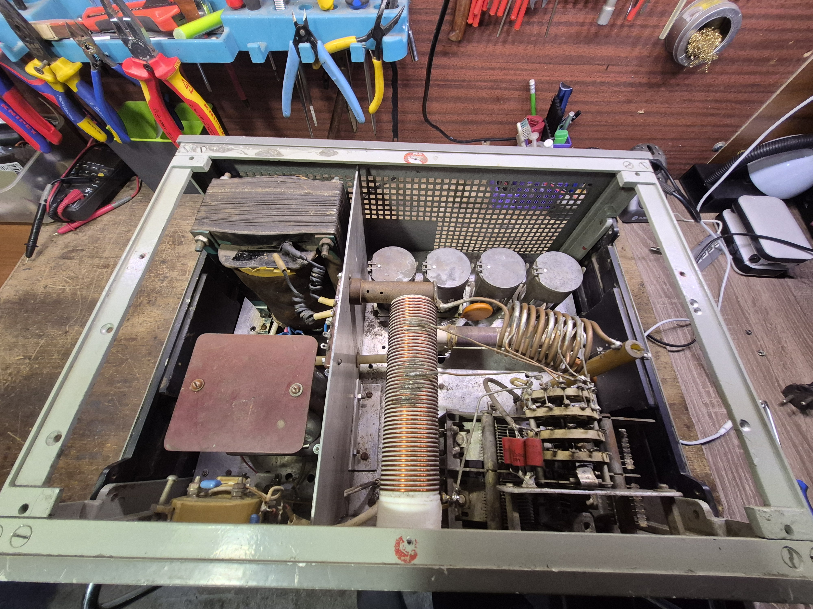
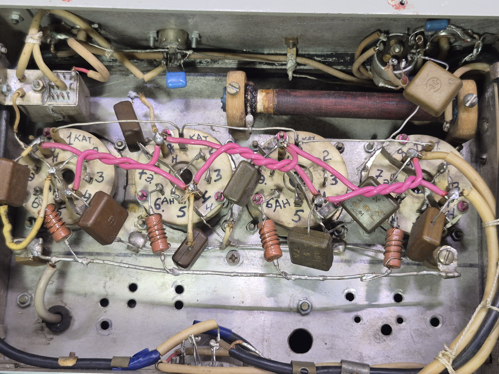
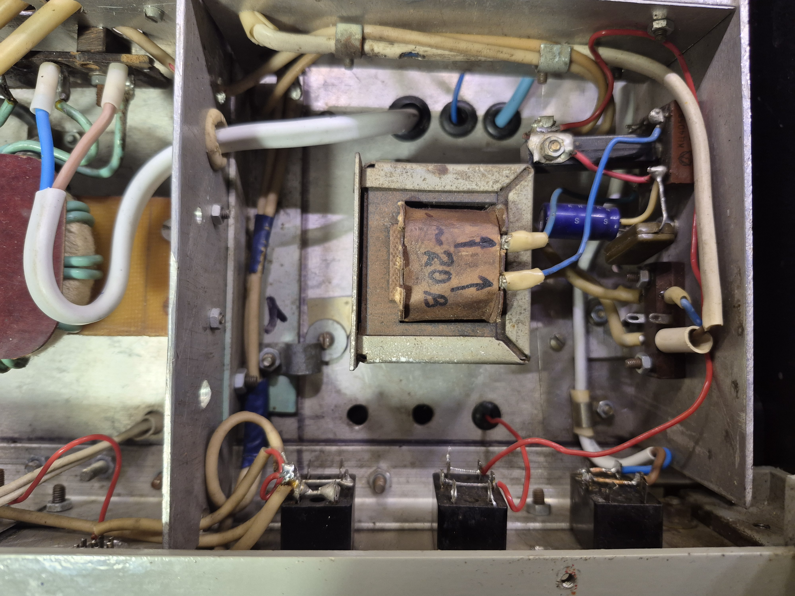
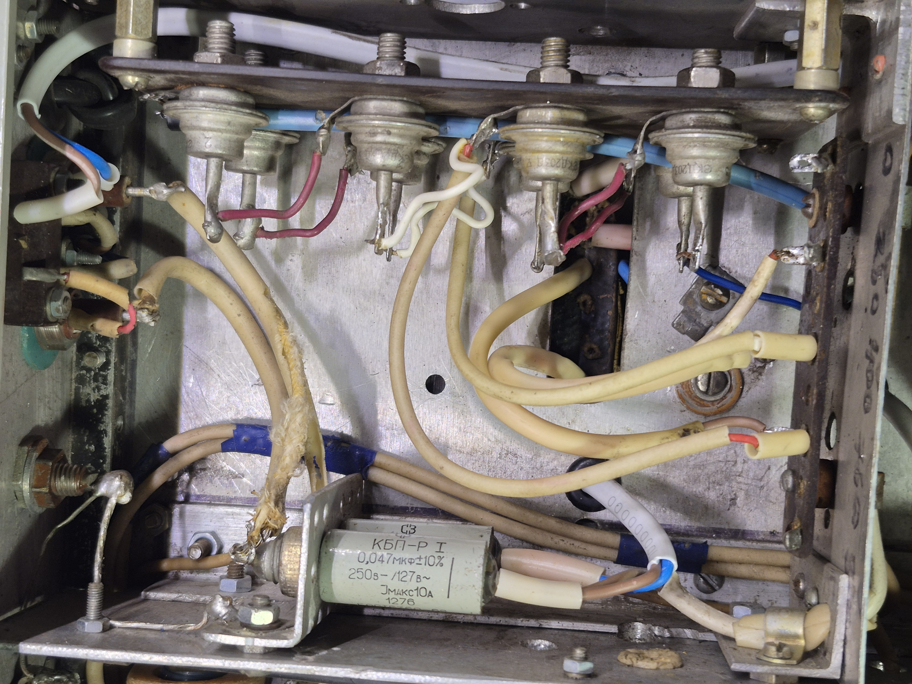

## Підсилювач для КХ радіостанції на 4х ГУ-50

- Анодна напруга: 1000 В
- Вихідна потужність: 200 Вт
- Діапазони: 160/80/40/20/15/10 м

# Вигляд зі знятою верхньою кришкою

# Розпайка ламп ГУ-50

# Трансформатор службової напруги 24В

# Випрямляч 1000 В

